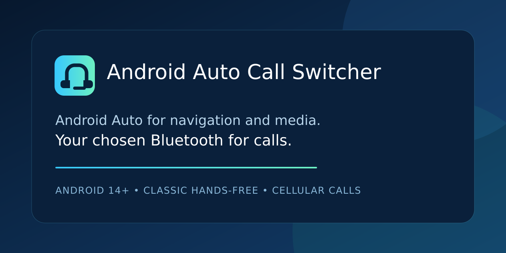

# Android Auto Call Switcher



[](https://github.com/itaymatza/android-auto-call-switcher/actions/workflows/build.yml)
[](https://github.com/itaymatza/android-auto-call-switcher/actions/workflows/codeql.yml)
[](https://github.com/itaymatza/android-auto-call-switcher/releases)
[](https://github.com/itaymatza/android-auto-call-switcher/releases)
[](LICENSE)

[**Download latest APK release**](https://github.com/itaymatza/android-auto-call-switcher/releases) · [All versions and release notes](https://github.com/itaymatza/android-auto-call-switcher/releases)


**Use your chosen Bluetooth device for call speaker and microphone audio while Android Auto handles everything else.**

The installed app is named **Android Auto Call Switcher**. The canonical source repository is
`itaymatza/android-auto-call-switcher`. GitHub redirects the previous repository links; the
installed package and signing identity stay stable for in-place updates.

## The problem

Android Auto can take over call audio even when you want calls on a separate Bluetooth device.
That preferred device might be earbuds, a headset, a speakerphone, or a car's hands-free system.
The goal is to choose that call device once while keeping Android Auto available for maps, music,
and its other functions.

Android Auto Call Switcher automates the same choice a user can make from the active-call audio selector:
when an eligible cellular call becomes active, it asks Android Telecom to use a **current,
user-chosen Bluetooth call endpoint**. Android Auto remains connected for navigation and media.
The app does not become the default dialer or manipulate general media routing through
`AudioManager`.

### Common symptoms this project targets

- Android Auto uses the wrong or poor-quality microphone for phone calls.
- Calls go through an aftermarket Android Auto head unit instead of the car's native Bluetooth.
- You want Android Auto to stay connected for maps and music while another Bluetooth HFP device
  handles call speaker and microphone audio.
- Manually selecting the preferred Bluetooth call device during every call works, but you want that
  call-audio selection automated.

If those phrases describe your problem, start with [Is this for me?](#is-this-for-me) and the
[compatibility guide](docs/DEVICE-COMPATIBILITY.md).

See the [product contract and implementation review](docs/PRODUCT-GOAL.md) for the exact goal,
implemented safeguards, and remaining transport/setup limitations.

## Is this for me?

It may fit when all of these are true:

- the phone runs Android 14 or newer;
- Android Auto and the preferred Bluetooth hands-free device are connected at the same time;
- manually choosing that Bluetooth device during a call already fixes both speaker and microphone;
- a one-time ADB authorization is acceptable.

It is not a fix for pairing failures, broken Bluetooth hardware, media-routing problems, emergency
calls, or systems where the preferred device is absent from Android's in-call audio selector. See
the [compatibility guide](docs/DEVICE-COMPATIBILITY.md) and [FAQ](docs/FAQ.md) before installing.


> This repository contains source code, deterministic tests, and a build workflow. The tracked source tree does **not** include device configurations, Bluetooth addresses, signing materials, APKs, or exported logs. Successful GitHub Actions runs publish a generated debug APK as a downloadable build artifact.

## Project status

Earlier owner testing established that the Telecom approach can move a call to the preferred device, but recent calls exposed unreliable routing and misleading endpoint indications. Version `0.3.0-beta.21` addresses a specific failure: Telecom can accept a request for its already-selected endpoint without changing Bluetooth call audio.

The app waits until answer and the startup quiet window. If Telecom already displays the preferred device while another uniquely identified device owns HFP audio, it reconciles the displayed endpoint with that stable observed owner first, verifies the change, then makes the single preferred-device request. Ordinary transitions need only the preferred-device request. The budget is **one target request plus at most one preceding reconciliation**, with fresh eligibility and identity checks throughout. A request result alone never proves audio success.

A prominent current call-audio indicator distinguishes observed target audio, disagreement, other-device audio and unknown evidence. Explicit wrong-audio reports and known routing failures remain visible in saved results. Independent Telecom/HFP simulations cover delayed transitions, callback order, absent configuration, rejected recovery and persistent failure. Physical speaker/microphone reliability still needs qualification on the new APK. See the [research and verification record](docs/ROUTING-RELIABILITY-2026-10-20.md) and [production-readiness gates](docs/PRODUCTION-READINESS.md).

## Public-repository posture


The tracked tree contains no real target-device settings. Device names and Bluetooth addresses are selected at runtime and stored only in the application’s private local preferences. Generated APKs, IDE configuration, local SDK configuration, test logs, captures, and conventional key/certificate files are excluded by `.gitignore`. GitHub Actions compiles, unit-tests, lints, and verifies the source. Normal builds upload an expiring debug artifact; after the host contracts and Android build both pass on `main`, the same workflow publishes a commit-specific debug pre-release signed with a protected, persistent key with an APK, digest, and verification report. A failed gate publishes no new APK. No APK is committed to the repository.


A public repository still exposes its files, commit history, issue/discussion content, and workflow logs. Do not commit exported logs, screenshots, pairing records, keystores, certificates, API keys, or private test notes. If the repository should not be forked, copied, or associated with its GitHub owner, use a private repository and consider a separately planned history rewrite.


## Configuration


### Build-time identity


The source namespace is the generic value `org.carcallrouter.companion`. Override the installed application ID and version metadata through Gradle properties without changing source:


```sh
bash gradlew \
  -PAPP_APPLICATION_ID=example.callroute \
  -PAPP_VERSION_CODE=23 \
  -PAPP_VERSION_NAME=0.3.0-beta.21 \
  :app:assembleDebug
```


`APP_APPLICATION_ID` defaults to `org.carcallrouter.companion`; `APP_VERSION_CODE` defaults to `23`; and `APP_VERSION_NAME` defaults to `0.3.0-beta.21`. Choose an application ID that you control before distributing a build. The source namespace remains generic and fixed so Kotlin and manifest class references stay consistent.


### Runtime configuration


The app is configuration-driven at runtime and has no car-brand matching rules. Select a paired classic Bluetooth HFP call device—a headset, earbuds, speakerphone, or car system—regardless of brand. LE Audio-only targets are not supported by the current audio verification backend. This is a capability-based design; only the documented Samsung/BMW setup has owner-confirmed physical test evidence so far. Grant the requested runtime permissions, select the exact paired call device, complete the one-time ADB authorization, and verify the result in the app. If the Android Auto head unit is a separate Bluetooth call device, optionally select that exact competing device. This restricts recovery to that device. Without this optional setting, recovery still requires the sole observed HFP owner to resolve uniquely through fresh live identity evidence. The UI contains no built-in device name, address, car brand, phone brand, or dialer requirement.

## Why ADB is required

`MANAGE_ONGOING_CALLS` is a `signature|appop` permission. Android documents the companion path specifically for a physical **wearable**; associating a car is not a supported general grant mechanism. A normal utility APK also cannot request this permission through a runtime dialog. The other supported route is becoming the default dialer, which requires a complete dial pad plus incoming and ongoing call UI and would replace the user's existing Phone experience. This project deliberately does not impersonate an incomplete dialer.

The selected architecture is therefore a non-UI `InCallService` with a one-time ADB AppOps grant. The app checks `TelecomManager.hasManageOngoingCallsPermission()` and never treats a command, button tap, or service declaration as proof of authorization.


See the exact [authorization and troubleshooting guide](docs/AUTHORIZATION.md), [configuration guidance](docs/CONFIGURATION.md), [safety and privacy boundaries](docs/SAFETY.md), and [testing guidance](docs/TESTING.md).


## Releases and downloads

[GitHub Releases](https://github.com/itaymatza/android-auto-call-switcher/releases) is the canonical version
history. Each published version has release notes and durable downloadable files, so a GitHub
account is not required just to download the APK.

| Version | Channel | Downloads |
| --- | --- | --- |
| `0.3.0-beta.21` | Android 14+ debug beta | [Latest commit-specific APK, SHA-256, and verification report](https://github.com/itaymatza/android-auto-call-switcher/releases) |
| `0.3.0-beta.10` | Previous Android 14+ debug beta | [Release](https://github.com/itaymatza/android-auto-call-switcher/releases/tag/v0.3.0-beta.10-debug) |
| `0.3.0-beta.9` | Previous Android 14+ debug beta | [Release](https://github.com/itaymatza/android-auto-call-switcher/releases/tag/v0.3.0-beta.9-debug) |
| `0.3.0-beta.7` | Previous Android 14+ debug beta | [Release](https://github.com/itaymatza/android-auto-call-switcher/releases/tag/v0.3.0-beta.7-debug) |
| `0.3.0-beta.6` | Previous Android 14+ debug beta | [Release](https://github.com/itaymatza/android-auto-call-switcher/releases/tag/v0.3.0-beta.6-debug) |
| `0.3.0-beta.5` | Previous Android 14+ debug beta | [Release](https://github.com/itaymatza/android-auto-call-switcher/releases/tag/v0.3.0-beta.5-debug) |

A new debug APK is published for each successful push to `main` on the [Releases page](https://github.com/itaymatza/android-auto-call-switcher/releases). Each file and version includes the source commit ID. Protected debug signing must be configured before publication; the pinned certificate blocks unexpected keys. The first protected-key APK requires a one-time reinstall for users of beta.11 or the initial beta.12 build. Later protected-key builds can update each other in place.

## Download and install the APK

The easiest path is the durable direct download:

1. Open [GitHub Releases](https://github.com/itaymatza/android-auto-call-switcher/releases) and download the `.apk` from the newest `0.3.0-beta.21` debug pre-release.
2. Open the downloaded APK on the Android device.
3. If Android prompts you, temporarily allow **Install unknown apps** for the browser or file
   manager, install the APK, and then disable that permission again.

For updates, use the newest protected-key APK and install it over the existing app. If Android rejects the update, compare the installed version and signing channel with the release notes first. Uninstall only when migrating from the documented older temporary-key builds or another signing channel; uninstalling clears settings and the ADB grant.

> This is a durable debug/test pre-release for Android 14+, not a production-ready signed release.
> Installation alone does not grant protected Telecom access. Open the app and complete the
> one-time authorization flow below. See the [release notes](docs/DEBUG-PRERELEASE-NOTES.md) and
> [production-readiness gates](docs/PRODUCTION-READINESS.md).

The [Actions build artifact](https://github.com/itaymatza/android-auto-call-switcher/actions/workflows/build.yml)
remains available as a fallback for testing the newest `main` commit, but it requires a GitHub
sign-in, downloads as a ZIP, and expires.

### Authorize call routing in the app

1. Pair the intended car or headset in Android's Bluetooth settings and keep it nearby and powered on.
2. Open Android Auto Call Switcher and select **Allow permissions**.
3. Select **Choose Bluetooth device**, then choose the intended call device.
4. Select **Set up one-time ADB authorization** and follow the displayed steps.
5. Return to the app and tap **Verify**. Continue only after the status says authorization is detected.
6. In **Test safely**, check the selected device’s current call transport. Classic HFP is required; an LE Audio or hearing-aid connection alone is not enough.
7. After a parked test call, use **Record parked call test** to report speaker, microphone, navigation, and media resumption separately. Export the redacted log alongside the captured run; reports do not automatically certify physical audio.

See the exact [authorization and troubleshooting guide](docs/AUTHORIZATION.md), [configuration guidance](docs/CONFIGURATION.md), [research decision](docs/PLATFORM-RESEARCH.md), [diagnostic evidence and system captures](docs/DIAGNOSTIC-EVIDENCE.md), and [parked-car test procedure](docs/TESTING.md).

For repeatable in-place beta upgrades, configure the protected signed build described in
[stable beta signing](docs/SIGNING.md). Ordinary GitHub debug artifacts do not have a stable
certificate across hosted runners; the signed workflow also pins the expected certificate digest.

## Project documentation


See the [product completeness audit](docs/PRODUCT-COMPLETENESS.md) for remaining functionality and
real-device qualification. Repository branding and canonical links are aligned.

Start with the [FAQ](docs/FAQ.md) and [compatibility guide](docs/DEVICE-COMPATIBILITY.md). Read the
[architecture reference](docs/ARCHITECTURE.md) for the component boundaries and routing state
machine. The [public-release guide](docs/PUBLIC_RELEASE.md) explains what remains visible in a
public repository and how to review a change before pushing it. The
[app metadata guide](docs/APP-METADATA.md) keeps the installed identity, release hub, and reusable
store listing aligned. Contributors should follow
[CONTRIBUTING.md](CONTRIBUTING.md); suspected security, privacy, or safety vulnerabilities belong
in the private reporting path described by [SECURITY.md](SECURITY.md), not a public issue.


## Safety model and limitations


The policy requires Telecom authorization, runtime permissions, a verifiably SIM-backed non-emergency call, a single active call, an exact target present in Telecom and HFP state, and verified projection for automatic mode. Evidence may arrive for up to ten seconds. Call-start routing settles for 300–900 ms after answer. The single target request allows four seconds for fresh, stable target HFP audio. Before that request, a pre-existing Telecom/actual-owner mismatch requires one reconciliation to a sole owner observed stably for at least 500 ms; samples older than 750 ms cannot authorize it. Reconciliation must produce the expected endpoint and fresh matching ownership within 2.5 seconds before the single target request. The maximum is two commands, never a loop. Stale or ambiguous identity, changed ownership, lost eligibility and observed external control block recovery. Protected handset, speaker, wired and unrelated Bluetooth choices stop automation. An already-submitted platform request cannot be recalled, and Android does not reliably expose the source or intent of every endpoint request. The manual routing action bypasses only the automatic toggle and projection gate. See the [safety analysis](docs/ROUTING-RELIABILITY-2026-10-20.md).


Routing uses API 34+ `requestCallEndpointChange()` with an endpoint object from the latest `onAvailableCallEndpointsChanged()` callback. The deprecated `requestBluetoothAudio(BluetoothDevice)` path has been removed. Because the public endpoint API exposes a name and UUID but no Bluetooth address, the app resolves identity only when the selected device’s current name or alias uniquely matches a live Bluetooth endpoint without a connected peer-name conflict or when exactly one HFP device and one Bluetooth endpoint exist. Ambiguity fails closed. Endpoint UUIDs are not persisted.

Diagnostics deliberately distinguish `TELECOM_ENDPOINT_CONFIRMED` from
`TARGET_HFP_AUDIO_CONFIRMED`. The former means Telecom selected the intended endpoint object; the
latter also corroborates that the exact locally configured Bluetooth address owns HFP audio/SCO.
Neither replaces a parked physical microphone and speaker test.


> Configure and test only while parked. Do not rely on this project for emergency, safety-critical, or hands-free compliance use cases.


## Verification

Run `bash tools/test-all.sh` for the pure-JVM core, deterministic property, exhaustive eligibility, JSONL replay, and service-callback suites. CI enforces at least 95% line / 90% branch coverage for `:core` and 90% line / 75% branch coverage for the production Telecom-service boundary, excluding framework stubs and test drivers. Host contracts also run on JDK 17 and 21. The pull-request workflow uploads HTML/XML coverage and JUnit reports, assembles the APK, runs Android lint, verifies APK signature and manifest identity, and reruns when a PR is retargeted to `main`. Passing those checks does not establish stable Samsung, Android Auto, Bluetooth, microphone, or speaker behavior; use the parked-car procedure and stability matrix in [testing guidance](docs/TESTING.md).

For repeatable real-device evidence, run
`bash tools/capture_device_run.sh --serial PHONE_SERIAL --scenario outgoing` while parked. The
harness stores only new structured app traces plus explicit physical observations in a local,
Git-ignored run directory and emits `PASS` only when exact HFP audio and all required observations
agree. Each session includes a privacy-safe device/app environment record and deduplicated evidence
snapshots showing Telecom's route beside the actual HFP/SCO owner. Controlled tags classify each
matrix cell, and

```sh
python3 tools/summarize_qualification.py verification/device-runs --require-ready
```

verifies that the batch used one APK/phone build and reached every required passing count.
